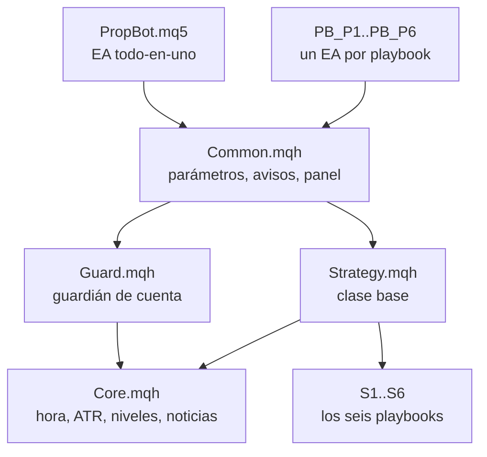

# PropBot

Expert Advisor para **MetaTrader 5 (MQL5)** con seis playbooks de trading institucional independientes (Oro, EURUSD y GBPUSD) y un **guardián de cuenta** que protege las reglas de una cuenta de fondeo.

Configurado por defecto para **FundingPips 2 Step Pro de 5.000 USD** (pérdida diaria 3%, pérdida máxima estática 6%), pero los límites se pueden cambiar en los parámetros.

> **Estado: sin compilar ni probar.** El código se escribió sin acceso a MetaEditor. Es posible que dé errores de compilación. No lo uses con dinero real sin compilarlo, hacer backtest y operar en demo. Esto es material educativo, no asesoría financiera, y ninguna estrategia tiene rendimiento garantizado.

## Qué hace

- **Seis playbooks independientes:** Regla del 80% (perfil de volumen), VWAP con bandas y Anchored VWAP, sweep de liquidez en Londres, absorción con order flow (aproximada), Opening Range / Initial Balance y Spring/Upthrust de Wyckoff. Cada uno tiene su propio magic number, sus límites diarios y su propia gestión de posición.
- **Guardián de cuenta compartido:** no genera señales. Autoriza o bloquea entradas, cierra todo si se tocan los topes internos y avisa antes de llegar a ellos.
- **Solo opera en Frankfurt, Londres y Nueva York**, con ventanas editables en hora de Nueva York y cierre total antes del final de la última sesión.
- **Monitoreo:** panel en el gráfico y notificaciones push al móvil.

## Arquitectura

Hay dos formas de usarlo; elige una, y no uses el mismo playbook en dos EAs sobre el mismo símbolo:

| Opción | Archivos | Cuándo conviene |
| --- | --- | --- |
| Todo en uno | `PropBot.mq5` | Menos gráficos: un EA por símbolo con un interruptor por playbook |
| Un robot por playbook | `PB_P1_Rule80.mq5` a `PB_P6_Wyckoff.mq5` | Poder pausar o quitar un playbook sin tocar los demás |

Todos los EAs comparten el mismo guardián mediante variables globales del terminal, así que los topes de riesgo se aplican al conjunto de la cuenta aunque los robots sean independientes.

## Los cuatro archivos principales

### `Core.mqh` - la caja de herramientas

Lo que todos los demás archivos necesitan saber del mercado:

- **Configuración compartida** (`SConfig`): balance, topes, lotes, sesiones, noticias.
- **Hora de Nueva York** con horario de verano de EE. UU., a partir del desfase del servidor del broker. Define también el inicio del día de trading (17:00 NY).
- **ATR** (14 periodos) con caché de handles, en el timeframe que pida cada estrategia.
- **Niveles del día**, recalculados en cada barra M5 cerrada: POC/VAH/VAL del día anterior (70%), máximo, mínimo y cierre de ayer, rango asiático, VWAP de sesión y su desviación, rango de hoy.
- **Filtro de noticias** con el calendario económico de MT5 (impacto alto). No funciona en el probador de estrategias.
- **Cálculos de volumen y dinero:** convierte una distancia de stop en dinero de la cuenta y normaliza el lote al paso del broker.

### `Guard.mqh` - el guardián de cuenta

Protege la cuenta aunque no estés mirando:

- Guarda la **referencia diaria** (el mayor entre balance y equity al abrir el día) y mide la pérdida desde ahí.
- Mantiene **dos pisos internos más estrictos que los de la firma:** diario 2% y máximo 4% del balance inicial.
- Antes de cada entrada comprueba: riesgo por operación (0,5%), riesgo abierto total (1,5%) y el **peor caso**: si todos los stops abiertos más el nuevo saltaran, el equity no puede romper los pisos internos.
- En cada tick: si el equity toca un piso, **cierra todas las posiciones del bot y bloquea** (diario hasta el día siguiente; máximo de forma permanente hasta revisión manual).
- **Avisos** al 50% y al 75% de cada tope y alerta crítica al bloquear.
- Comparte estado entre gráficos y EAs con variables globales del terminal.

### `Common.mqh` - lo común a todos los EAs

- Define los **parámetros** que ves al adjuntar cualquier robot (cuenta, guardián, lotes, noticias, sesiones, avisos).
- `PB_InitConfig` lee los parámetros y valida que los topes internos sean menores que los de la firma.
- `PB_TickCommon` activa el guardián, los avisos y el cierre al final de la última sesión en cada tick.
- `PB_NewBar`, `PB_Dashboard` y `PB_ParseDeal` (nueva barra M5, panel en el gráfico, aviso de cada operación abierta o cerrada y conteo de pérdidas).

### `PropBot.mq5` - el EA todo-en-uno

Crea los seis playbooks, cada uno con su magic number (880001 a 880006) y sus propios parámetros: activo o no, multiplicador de riesgo, operaciones máximas por día, pérdidas seguidas que lo pausan y sesiones permitidas. En cada tick activa el guardián y deja que cada playbook gestione sus posiciones. En cada barra M5 cerrada recalcula niveles y deja que cada uno busque su señal. Los playbooks no se ven entre sí.

Archivos restantes: `Strategy.mqh` (clase base: lote, órdenes, parcial en TP1, equilibrio, trailing, cierre por tiempo), `S1_Rule80.mqh` a `S6_Wyckoff.mqh` (los playbooks) y `PB_P1..PB_P6.mq5` (un EA por playbook).

## Los seis playbooks

| # | Playbook | Idea | Sesión por defecto |
| --- | --- | --- | --- |
| 1 | Regla del 80% | Apertura fuera del área de valor de ayer y vuelta a ella: recorrido hasta el otro extremo | F, L, N |
| 2 | VWAP / AVWAP | Reversión en bandas de ±2σ o continuación en el retroceso al VWAP anclado | F, L, N |
| 3 | Sweep de liquidez | Barrida del rango asiático o del día previo y reversión | F, L |
| 4 | Absorción | Absorción y divergencia de delta en niveles clave (delta aproximado por ticks). **Desactivado por defecto** | F, L, N |
| 5 | Opening Range / IB | Ruptura con volumen o ruptura fallida del rango inicial | F, L, N |
| 6 | Spring / Upthrust | Perforación falsa de un rango H1 con recuperación rápida | F, L, N |

Los umbrales de cada playbook son valores de partida, no están optimizados.

## Instalación

1. En MetaTrader 5: Archivo > Abrir carpeta de datos > `MQL5` > `Experts`.
2. Crea ahí la carpeta `PropBot` y copia **todos** los archivos juntos, sin subcarpetas (los `.mq5` incluyen a los `.mqh` por nombre).
3. Abre el robot que vayas a usar en MetaEditor (F4) y compílalo (F7). Solo se compilan los `.mq5`.
4. Adjúntalo a un gráfico **M5** de EURUSD, GBPUSD o XAUUSD. Activa el trading algorítmico y permite el calendario económico en Herramientas > Opciones > Asesores Expertos.

## Parámetros principales

| Grupo | Parámetro | Valor por defecto |
| --- | --- | --- |
| Cuenta | `InpInitialBalance` | 5000 |
| Cuenta | `InpFirmDailyPct` / `InpFirmMaxPct` | 3,0 / 6,0 |
| Guardián | `InpDailyStopPct` / `InpMaxStopPct` | 2,0 / 4,0 |
| Guardián | `InpMaxOpenRiskPct` | 1,5 |
| Guardián | `InpMaxRiskTradePct` | 0,50 |
| Lotes | `InpLotMode` | `LOT_FIXED` (0,08 divisas / 0,01 Oro) |
| Noticias | `InpUseNews` / `InpNewsMinutes` | true / 15 |
| Sesiones | Frankfurt / Londres / Nueva York (hora NY) | 02:00-11:00 / 03:00-12:00 / 08:00-17:00 |
| Sesiones | `InpFlatAtEnd` / `InpFlatTime` | true / 16:45 |
| Avisos | `InpPush` | true |

El EA no arranca si los topes internos son iguales o mayores que los de la firma.

Para los avisos al móvil: instala MetaTrader 5 en el teléfono, copia tu MetaQuotes ID (Ajustes > Mensajes) y pégalo en el terminal de escritorio en Herramientas > Opciones > Notificaciones.

## Limitaciones conocidas

- **Playbook 4:** en CFD no hay volumen real ni bid/ask por nivel; el delta se aproxima con la dirección de los ticks. No equivale a un footprint real.
- Los volúmenes (perfil, VWAP, picos) son volumen de **ticks** del broker, no volumen real de futuros.
- La referencia diaria se toma al iniciar el EA si este arranca a mitad del día, y puede diferir de la de la firma.
- La hora de Nueva York usa el desfase servidor-GMT detectado, que en el probador puede ser incorrecto: fija `InpAutoOffset = false` y `InpManualOffsetH`.
- No hay reintento de órdenes rechazadas ni protección contra desconexión. Si el terminal o el VPS se apagan, el guardián deja de vigilar (los stops siguen en el servidor del broker).
- Las reglas de tu firma de fondeo pueden cambiar. Verifica en su centro de ayuda si permiten EAs propios, noticias, hedging y cómo calculan el límite diario.

## Antes de usarlo con dinero

1. Compila y corrige errores.
2. Backtest por playbook (uno activo cada vez) en modo ticks reales y varios años; mide expectativa en R y drawdown.
3. Demo durante 2 a 3 meses o al menos 100 operaciones.
4. Solo entonces cuenta de evaluación, con los topes internos intactos.

## Licencia

Por definir. Añade aquí el archivo `LICENSE` que prefieras antes de publicar el repositorio.

## Aviso

Este proyecto es educativo. Operar con instrumentos apalancados implica riesgo de pérdida. El autor no ofrece asesoría financiera ni garantiza resultados.
